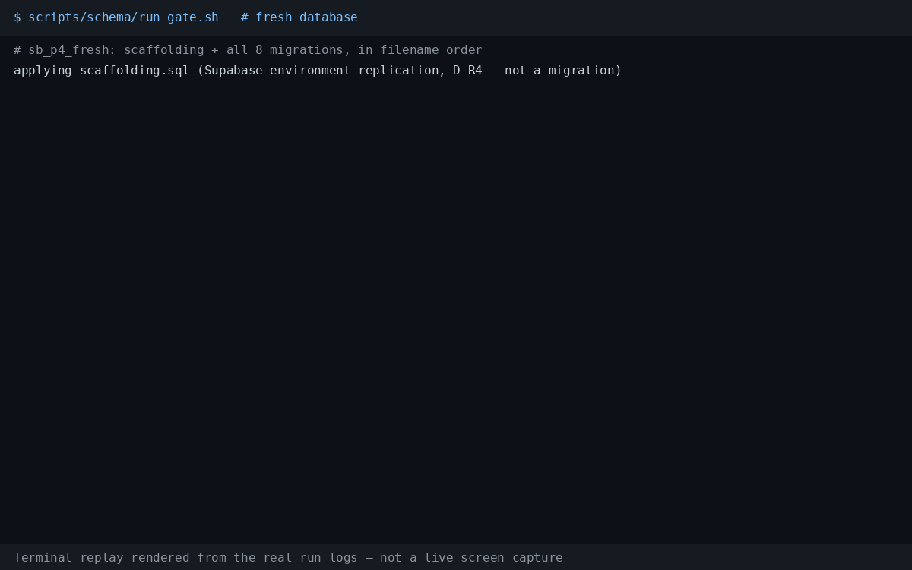
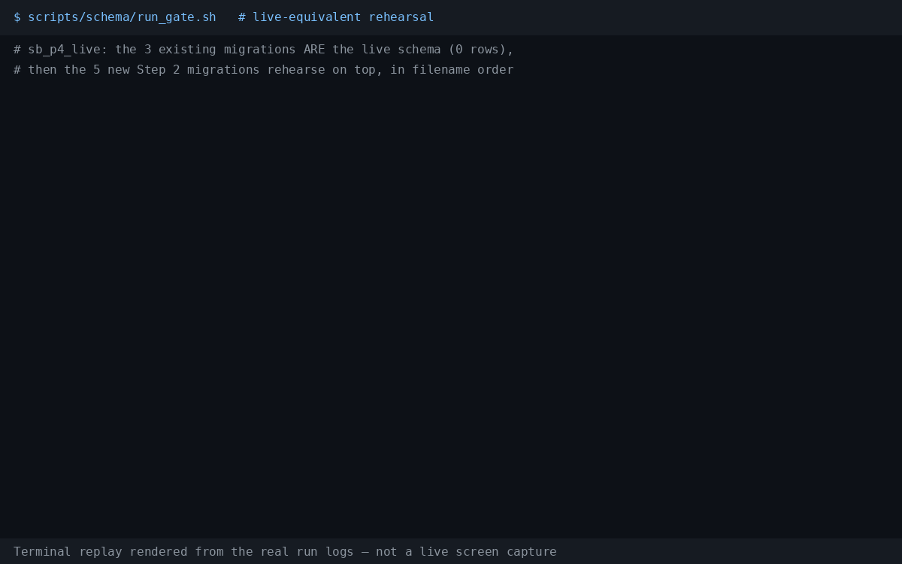
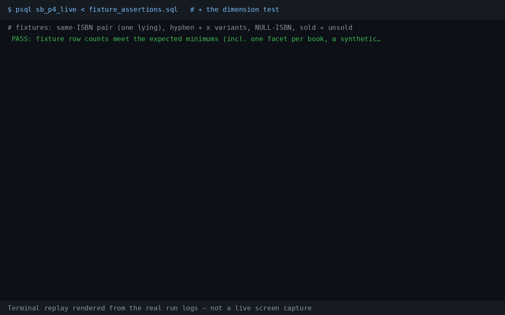
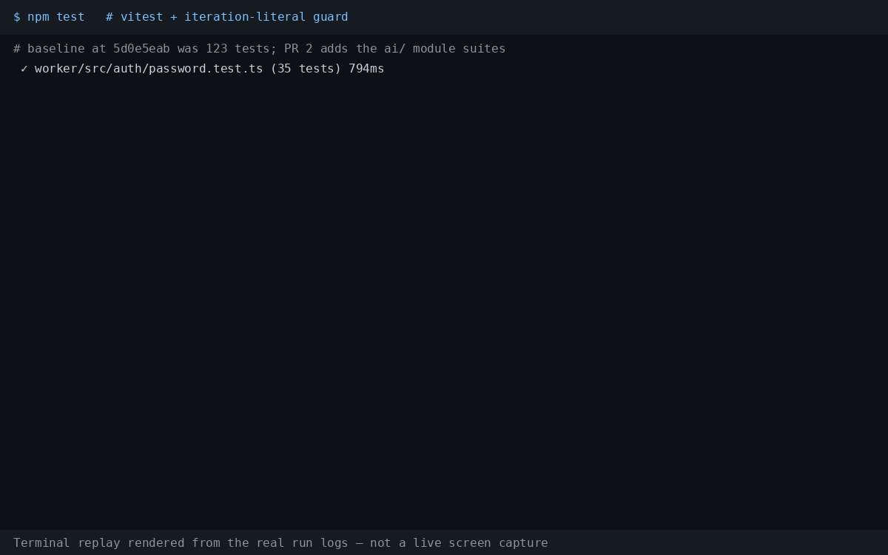

# Schema gate harness — P4 Step 2 (PR 2)

Rehearses the P4 schema migrations against a scratch Postgres and proves
they behave, before anything is applied to the real Supabase project.
The harness is bash + `psql` for the schema half (decision D-R3 in
`docs/PR2-BUILD-LOG.md`: no Docker in the rehearsal environment, and
the repo's vitest suite never opens a database); the same script also
runs `npm test` once at the end and captures it to `npm-test.log`, so
every log the GIF renderer consumes comes from one harness run.

## Files

| File | What it is |
|---|---|
| `run_gate.sh` | The harness. Creates the two scratch DBs, applies scaffolding + migrations + fixtures, runs the assertions and the dimension test, writes logs, prints a PASS/FAIL summary. |
| `scaffolding.sql` | **Environment replication, not a migration** — see the honesty note below. |
| `fixtures.sql` | Synthetic gate data for the live-equivalent DB only (snapshot `fixture-2026-11-11`): two merchant stores + one customer store, listings covering the same-ISBN pair / lying ISBN, hyphen-variant and lowercase-x ISBN-10 variants, a NULL-ISBN 红楼梦， one sold listing, plus the reference catalogue, facets, evidence, assertions, links, task, prompts, ai_runs, works projection and review-aspects rows. Everything is flagged `is_synthetic`. |
| `assertions.sql` | Schema-level assertions (DO blocks that raise on failure, `PASS …` selects on success). No fixture dependency, so it runs against **both** DBs. |
| `fixture_assertions.sql` | Data assertions: fixture row counts, the Path A control join, the lying-ISBN join, the three CHECK-rejection probes (evidence candidates, listing-link target shape, assertion self-pair), task claimability. Live-equivalent DB only. |

## The D-R4 scaffolding honesty note

Vanilla Postgres lacks three things a real Supabase project pre-provides
and the existing repo migrations silently assume:

1. the `extensions` schema (migration 1 does
   `create extension … with schema extensions`);
2. the function `public.rls_auto_enable()` (migrations 2–3 revoke
   execute on it);
3. the `anon` and `authenticated` roles (those revokes name them).

`scaffolding.sql` creates all three before any repo migration runs.
That **replicates the Supabase environment; it is not part of any
migration file**, it must never be copied into `supabase/migrations/`,
and the harness says so in its output. Nothing in the rehearsal's
results depends on the scaffolding beyond letting the repo's own
migration files run verbatim, exactly as they run on Supabase.

## What a run does

1. **`sb_p4_fresh`** — scaffolding → all 8 migrations (3 existing + 5
   new) in filename order → `assertions.sql`.
2. **`sb_p4_live`** (live-equivalent) — scaffolding → all 8 migrations
   in the same order → `fixtures.sql` → `assertions.sql` →
   `fixture_assertions.sql`. The 3 existing migrations *are* the live
   schema and live tables hold 0 rows (owner recheck 2026-11-10), so
   applying the 5 new ones on top in filename order is the honest
   rehearsal of the live upgrade — there is no data migration to fake.
3. **Dimension test** (in `run_gate.sh`, deliberately not in the SQL
   files, because it must assert on a *failure*): the
   `books.embedding` switch from 384 to 1024 dimensions is **deferred**
   to the P5 change that retires/migrates the Python ai-service (whose
   live contract is 384 dimensions — see the header of
   `20261111130400_p4_ai_platform.sql`), so the test now proves the
   deferral: inserting a 384-dimension vector into `books.embedding`
   must **succeed**, and a 1024-dimension insert must exit non-zero
   with an error mentioning dimensions. The probe row is deleted
   afterwards. (The ref-side 1024 contract is unaffected and is
   asserted in `assertions.sql`: `ref_works.embedding` is
   halfvec(1024).)
4. **Test suite** — `npm test` runs in the repo root; output is
   captured to `npm-test.log` in the log directory (the file
   `make_gifs.py` renders the test-suite GIF from).
5. **No-op re-run (D-R5)** — migration tracking mirrors Supabase: each
   DB keeps a `p4_gate.applied_migrations` table and every file is
   applied exactly once. Re-running the apply step prints `NO-OP` and
   changes nothing; re-running the whole harness against a complete
   pair of DBs likewise applies nothing and only re-runs the read-only
   assertions. A DB that exists but is *incomplete* (an interrupted
   run) is dropped and recreated so the run starts deterministically;
   `GATE_FRESH=1` forces that drop+recreate even for a complete DB.
   (The fixed DB names, rather than per-run suffixed names, are what
   make the no-op re-run possible.) The step judges each database's
   re-apply by its own exit code — a fresh-DB failure can no longer be
   masked by a successful live-DB re-apply.

## How to run it

Prerequisites: a reachable Postgres 16 with **pgvector ≥ 0.8**
(`halfvec` support) and **pg_trgm** available, and a role that can
create databases. The server is scratch — the harness creates and may
drop `sb_p4_fresh` / `sb_p4_live` on it.

```sh
# connection via standard libpq environment:
PGHOST=localhost PGPORT=5432 PGUSER=postgres \
  scripts/schema/run_gate.sh

# …or pass an admin connection string as the first argument:
scripts/schema/run_gate.sh 'postgres://postgres@localhost:5432/postgres'

# choose a log directory (default scripts/schema/gate-logs/):
GATE_LOG_DIR=/tmp/p4-gate-logs scripts/schema/run_gate.sh

# force a from-scratch rehearsal even if a previous run completed:
GATE_FRESH=1 scripts/schema/run_gate.sh
```

Exit code is 0 only when every gate step passes. Per-step output lands
in the log directory: `fresh-setup.log`, `live-setup.log`,
`assertions-fresh.log`, `assertions-live.log`, `fixture-assertions.log`,
`dimensions.log`, `npm-test.log`, `noop-rerun.log`, and the running
`gate.log`.

## Watch it run (replays)

Terminal replays rendered from the real run logs of the 2026-11-13 gate
run (PostgreSQL 16.15 + pgvector 0.8.0, scratch cluster; the run that
verified the PR #63 review fixes) — each GIF carries the disclosure in
its footer; regenerate with
`GATE_LOG_DIR=<log dir> python3 scripts/schema/make_gifs.py`
(Pillow pinned in `scripts/schema/requirements.txt`).

- 
- 
- 
- 
